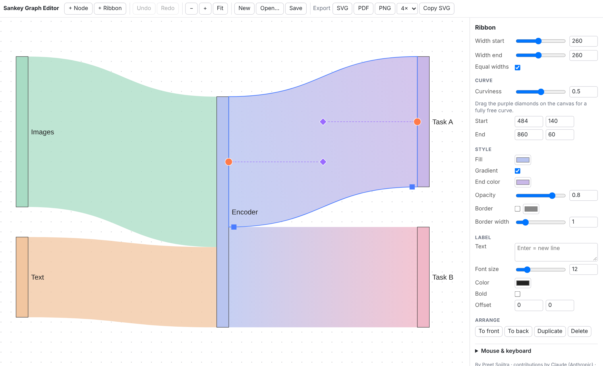

# Sankey Graph Editor

A Sankey diagram editor where you can drag everything by hand: nodes, ribbon ends, widths, curves. Export SVG, PDF or PNG.

**Try it:** https://preet-sojitra.github.io/sankey-graph-editor/

## Why

I needed a Sankey figure for a CVPR paper at 3 AM. Every tool I tried did the layout for me and wouldn't let me fix the curves the way I wanted, so I wrote my own. This is the cleaned-up version. (The original is in `archive/` if you're curious.)

## Usage

It's a single HTML file, so you can open `index.html` in a browser or use the link above.

- Select a node and drag its green dot to create a ribbon
- Orange dots move ribbon ends, blue squares change width, purple diamonds bend the curve
- Save/Open keeps a `.json` of your project. It also autosaves in the browser.
- Press `?` in the app for all shortcuts

For LaTeX, export PDF (choose "Save as PDF" in the print dialog, margins none), or convert the SVG with `inkscape fig.svg --export-type=pdf`. You can set the font to Times in the project panel to match your paper.

## Contributing

Issues and PRs welcome. Please keep it a single file with no dependencies.

## License

MIT. Made by [Preet Sojitra](https://github.com/Preet-Sojitra), with help from Claude.
